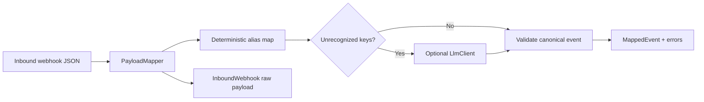

# Webhook Payload Mapper

Webhook Payload Mapper is a small Laravel 13 + Vue 3 demo that turns inconsistent inbound webhook JSON into the strict Harbor Desk event contract. Deterministic aliases handle known fields first. An optional LLM sees only leftover source keys and may suggest values for missing canonical fields; server-side validation remains authoritative.

## Architecture



`PayloadMapper` owns the fixed alias rules (`order_id`, `orderId`, `order_number`; `customer_email`, `email`) and validation. The `LlmClient` interface has a deterministic `FakeLlmClient` and an optional Gemini implementation. Suggestions can only fill empty canonical fields, and no LLM failure prevents mapping or validation. Calls to Gemini have a 12-second request timeout.

## Run locally

Requirements: PHP 8.3+, Composer, Node.js 22+, and npm.

```sh
composer setup
php artisan db:seed
php artisan serve
```

Open <http://localhost:8000>. Four fictional samples are seeded: a standard order, aliased keys, a missing email, and unknown vendor field names. No account is required. The application uses SQLite by default and does not need Redis.

### Run without an API key

Leave `GEMINI_API_KEY` empty (the default). The app binds `FakeLlmClient`, which demonstrates deterministic suggestions for a few common vendor-key patterns; unknown fields that cannot be confidently mapped remain notes and are not added to the output. The full mapper, aliases, and validation work offline.

To enable optional Gemini assist, set `GEMINI_API_KEY` in `.env`. `GEMINI_MODEL` can override the default `gemini-2.5-flash` model. Only unrecognized keys and the names of currently missing canonical fields are sent for suggestions.

## Harbor Desk event contract

| Field            | Type             | Rule                   |
| ---------------- | ---------------- | ---------------------- |
| `event_type`     | string           | Required               |
| `order_id`       | string or `null` | Optional               |
| `customer_email` | email or `null`  | Required and validated |

Try a payload with `POST /webhooks/map` using `Content-Type: application/json`. Send the webhook object directly, or use `{"payload_json": { ... }}` when calling from the UI. The response includes the normalized payload, validity, validation errors, and unrecognized source keys. Each request is recorded as an `InboundWebhook` and a `MappedEvent`.

## Tests

```sh
composer test
```

The Pest feature suite proves that an `orderId` alias maps to `order_id`, a missing email makes the event invalid, the fake LLM can be bound and safely suggest unknown fields, an unauthenticated webhook POST returns 200 and persists its mapping, and malformed JSON returns a controlled client error. No external model key or network access is required for tests.
